I build software for businesses and defend it. Developer at TBS Inform, team lead at [Vanking](https://vanking.uz), second-year Cybersecurity student at IT Park University in Tashkent.

&nbsp;&nbsp;

Results with evidence, case studies and CV are on [dmitriy.cv](https://dmitriy.cv) · [по-русски](https://dmitriy.cv/ru/)

### Results

- **1st place — School 21 CTF**, 13 November 2026. Team Vanking, captain. 12,271 points.
- **1st place — CyberSecurity Uzum Hackathon, round 2**, 24–25 October 2026. Defensive track, team lead. 38 points, SLA 98%, 32 of 52 items closed across five services. [Repository](https://github.com/Vanking-UZ/uzumhakaton) · [case study](https://dmitriy.cv/work/uzum-hackathon/)
- **74th of 1000 — CTF Cup of Russia, qualifying round**, 31 October – 1 November 2026. Solo, without AI tools.

### Code

- [**uzumhakaton**](https://github.com/Vanking-UZ/uzumhakaton) — external defence of five intentionally vulnerable services without touching application code: a mitmproxy policy behind a WAF, an SBE gateway, a Modbus/TCP gateway. Python.
- [**deduplicator**](https://github.com/asintiko/deduplicator) — offline Windows app that finds duplicate files by content, including perceptually similar images and audio, and never deletes without confirmation. C#, .NET 8, Avalonia.
- [**check-ID-telegram-bot**](https://github.com/asintiko/check-ID-telegram-bot) — returns Telegram IDs for a username, a forwarded message or a reply. JavaScript.

### Stack

